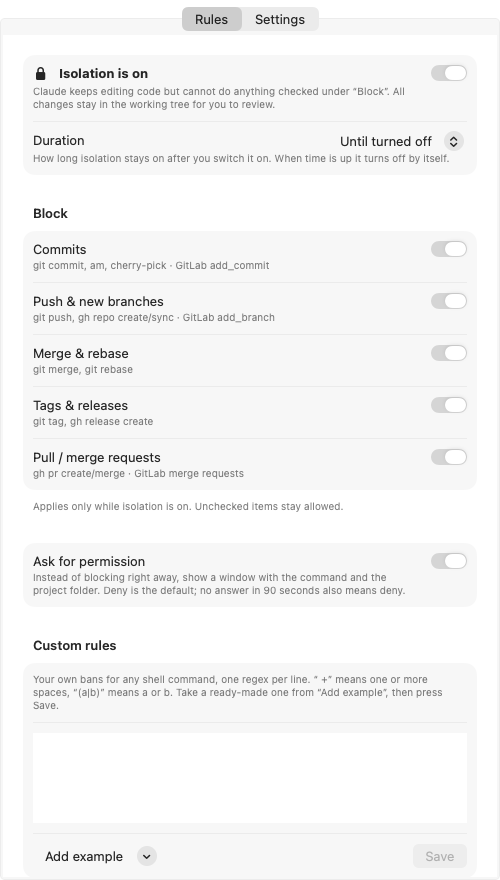
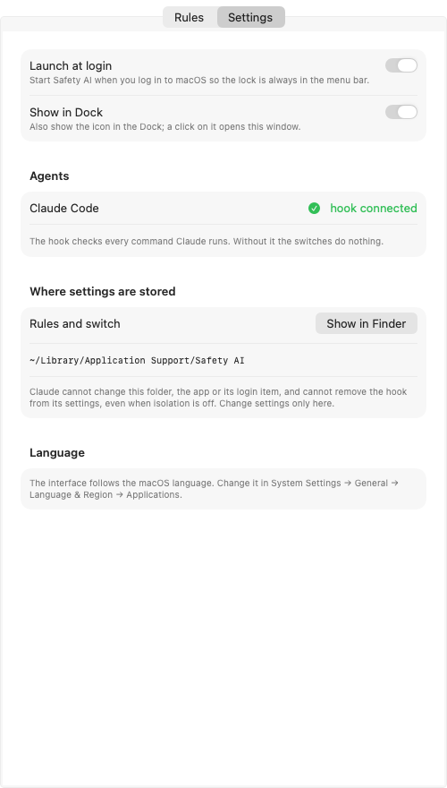

**English** | [Русский](README.ru.md)

# Safety AI

A macOS menu bar switch that stops [Claude Code](https://claude.com/claude-code) from committing, pushing
and doing whatever else you forbid.

Turn isolation mode on and Claude keeps editing code, but it won't `commit`, `push`, `merge`, `rebase`, tag
or open PRs/MRs in any repository, and it stops asking "should I commit?". All changes stay in the working tree.
Turn it off, or let the timer run out, and it behaves as usual.

## Install

Requires macOS 13+, Command Line Tools (`xcode-select --install`) and `jq` (bundled with macOS 15+).

```bash
git clone <repo> && cd safety-ai
./install.sh
```

The script:
1. puts the hook into `~/Library/Application Support/Safety AI/` and registers it in `~/.claude/settings.json`
   (the original is saved as `settings.json.bak-isolation`);
2. builds `~/Applications/Safety AI.app`;
3. on the first install adds a login item and launches the app.

Re-running is safe: hooks are not registered twice, the app is rebuilt, your settings are kept.

## Usage

A lock appears on the right side of the menu bar:
- 🔒 closed: isolation is on;
- 🔓 open: isolation is off.

Click the lock → "Isolation mode", or "Turn on for ▸" 15 min … 8 h. It takes effect immediately,
including in Claude sessions that are already open. With a timer the menu shows how much time is left,
and isolation turns off by itself when it runs out.

The same settings are in the lock menu and in the settings window (lock → "Settings…").
The app lives in the menu bar and shows in the Dock only while the settings window is open.

 

### Rules tab

**Duration**: how long isolation stays on after you switch it on, from 15 minutes to "until turned off".

**Block**: what isolation mode forbids. Everything is checked by default:

| Rule | Blocks |
|---|---|
| Commits | `git commit`, `am`, `cherry-pick`; GitLab MCP `add_commit` |
| Push & new branches | `git push`, `gh repo create/sync`; GitLab MCP `add_branch` |
| Merge & rebase | `git merge`, `git rebase` |
| Tags & releases | `git tag`, `gh release create` |
| Pull / merge requests | `gh pr create/merge`; GitLab MCP `save_merge_request`, `accept_merge_request` |

**Ask for permission**: instead of blocking right away, a window pops up with the command and the
project folder. **Allow** lets it through, **Deny** blocks it. Deny is the default button,
and no answer in 90 seconds also means deny.

**Custom rules**: your own bans for any shell command, one regex per line (` +` means one or more spaces).
"Add example" has ready-made ones:

| Rule | Blocks |
|---|---|
| `rm +-[a-z]*r` | recursive delete |
| `git +reset +--hard` | discarding uncommitted changes |
| `git +clean +-[a-z]*f` | deleting untracked files |
| `docker +compose +down` | stopping and removing containers |
| `docker +(rm\|rmi\|volume +rm\|system +prune)` | deleting containers, images, volumes |
| `kubectl +delete` | deleting Kubernetes resources |
| `(DROP\|drop\|TRUNCATE\|truncate) +(TABLE\|table\|DATABASE\|database)` | dropping tables and databases |
| `(npm\|yarn\|pnpm) +publish` | publishing a package |
| `(^\|[;&\|] *)ssh( \|$)` | connecting to servers |

### Settings tab

Launch at login, whether the hook is connected to Claude Code
and where the settings are stored.

## Where settings are stored

| What | Where |
|---|---|
| Switch (empty, or the end time for a timer) | `~/Library/Application Support/Safety AI/isolation` |
| Rules | `~/Library/Application Support/Safety AI/rules.conf` |
| Hook | `~/Library/Application Support/Safety AI/isolation.sh` |
| Hook registration | `~/.claude/settings.json` |
| Duration | macOS defaults, domain `local.safety-ai` |
| Login item | `~/Library/LaunchAgents/local.safety-ai.plist` |

`rules.conf` is plain text, one rule per line: `commit`, `push`, `merge`, `tag`, `pr`, `ask`, `deny <regex>`.
No file means all built-in rules are on and no dialog.

## How it works

- **`PreToolUse`**: before every Claude tool call the hook checks the switch. If it is on, it blocks whatever
  the rules list. Read-only commands (`git status`, `diff`, `log`) pass.
- **`UserPromptSubmit`**: every user message gets a reminder listing what is forbidden and "don't ask about it".
  Without it Claude would keep offering to commit.
- **Self-protection, always on** (even with isolation off): Claude cannot change the settings folder, the app
  or its login item, and cannot remove the hook from `settings.json`. This covers shell commands
  and the Write/Edit tools. Only you change settings, in the app.

```
app/main.swift       menu bar app and settings window (AppKit + SwiftUI, no dependencies)
app/*.lproj/         UI translations
app/AppIcon.icns     app icon
app/make-icon.swift  renders the icon
hooks/isolation.sh   Claude Code hook
install.sh           install
uninstall.sh         uninstall
test.sh              hook tests: ./test.sh hooks/isolation.sh
docs/                screenshots
```

## Languages

The app follows the macOS language setting (System Settings → General → Language & Region,
or per app via Applications → Safety AI). Bundled: English, Russian.

To add a language, copy `app/en.lproj` to `app/<code>.lproj` (e.g. `de.lproj`), translate the right-hand
strings in `Localizable.strings` and run `./install.sh` again. Pull requests with translations are welcome.

## Limitations

- This guards against accidents, it is not a sandbox: an agent deliberately looking for a bypass will find one
  (for example, a script file that does the forbidden thing).
- The hook matches command text, so it also blocks harmless commands that merely mention `git commit` or the
  settings folder in a string.
- The hook does not see git run through third-party MCP terminals (e.g. PhpStorm `execute_terminal_command`).
- The "Commit" button in Claude desktop is drawn by the app itself. Pressing it while isolation is on hits the hook.

## Uninstall

```bash
./uninstall.sh
```

Removes the app, the login item, the settings folder and the hook entries in `settings.json`
(backup: `settings.json.bak-uninstall`).

## License

[MIT](LICENSE)
