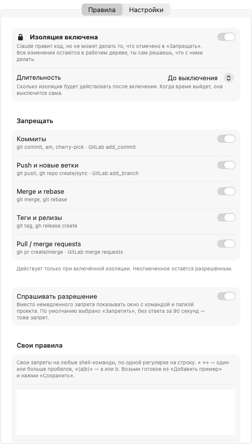
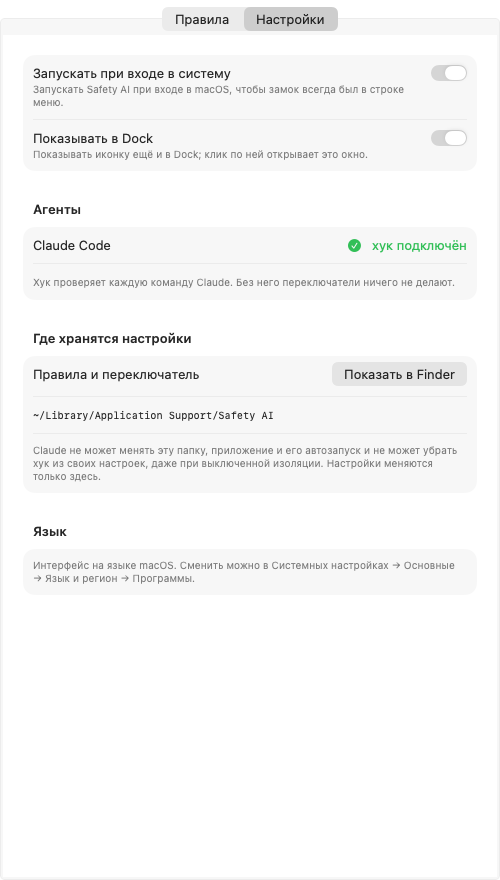

[English](README.md) | **Русский**

# Safety AI

Переключатель в строке меню macOS, который запрещает [Claude Code](https://claude.com/claude-code) коммитить,
пушить и делать всё остальное, что ты запретишь.

Включил режим изоляции: Claude правит код, но не делает `commit`, `push`, `merge`, `rebase`, теги и PR/MR
ни в одном репозитории и не спрашивает «закоммитить?». Все изменения остаются в рабочем дереве.
Выключил или вышло время таймера: Claude работает как обычно.

## Установка

Нужны macOS 13+, Command Line Tools (`xcode-select --install`) и `jq` (в macOS 15+ уже есть).

```bash
git clone <repo> && cd safety-ai
./install.sh
```

Скрипт:
1. кладёт хук в `~/Library/Application Support/Safety AI/` и подключает его в `~/.claude/settings.json`
   (исходный файл сохраняется как `settings.json.bak-isolation`);
2. собирает `~/Applications/Safety AI.app`;
3. при первой установке включает автозапуск и запускает приложение.

Повторный запуск безопасен: хуки не задваиваются, приложение пересобирается, настройки сохраняются.

## Как пользоваться

Справа вверху в строке меню появится замок:
- 🔒 закрытый — изоляция включена;
- 🔓 открытый — выключена.

Клик по замку → «Режим изоляции» или «Включить на ▸» от 15 мин до 8 ч. Действует сразу, в том числе в уже
открытых сессиях Claude. С таймером меню показывает, сколько осталось, а по истечении времени
изоляция выключается сама.

Те же настройки есть в меню замка и в окне настроек (замок → «Настройки…»).
Приложение живёт в строке меню и появляется в Dock, только пока открыто окно настроек.

 

### Вкладка «Правила»

**Длительность**: сколько изоляция действует после включения, от 15 минут до «до выключения».

**Запрещать**: что блокирует режим изоляции. По умолчанию отмечено всё:

| Правило | Что блокирует |
|---|---|
| Коммиты | `git commit`, `am`, `cherry-pick`; GitLab MCP `add_commit` |
| Push и новые ветки | `git push`, `gh repo create/sync`; GitLab MCP `add_branch` |
| Merge и rebase | `git merge`, `git rebase` |
| Теги и релизы | `git tag`, `gh release create` |
| Pull / merge requests | `gh pr create/merge`; GitLab MCP `save_merge_request`, `accept_merge_request` |

**Спрашивать разрешение**: вместо немедленного запрета всплывает окно с командой и папкой
проекта. **Разрешить** пропускает, **Запретить** блокирует. По умолчанию выбрано «Запретить» (Return).
Обратный отсчёт на кнопке «Запретить» и убывающая полоса показывают, что окно не будет ждать вечно:
если 90 секунд нет ответа — запрет.


**Свои правила**: свои запреты на любые shell-команды, по одной регулярке на строку (` +` — один или больше
пробелов). В «Добавить пример» есть готовые:

| Правило | Что блокирует |
|---|---|
| `rm +-[a-z]*r` | рекурсивное удаление |
| `git +reset +--hard` | сброс незакоммиченных изменений |
| `git +clean +-[a-z]*f` | удаление неотслеживаемых файлов |
| `docker +compose +down` | остановку и удаление контейнеров |
| `docker +(rm\|rmi\|volume +rm\|system +prune)` | удаление контейнеров, образов, томов |
| `kubectl +delete` | удаление ресурсов Kubernetes |
| `(DROP\|drop\|TRUNCATE\|truncate) +(TABLE\|table\|DATABASE\|database)` | удаление и очистку таблиц и баз |
| `(npm\|yarn\|pnpm) +publish` | публикацию пакета |
| `(^\|[;&\|] *)ssh( \|$)` | подключение к серверам |

### Вкладка «Настройки»

Автозагрузка, подключён ли хук к Claude Code, где хранятся настройки.

## Где хранятся настройки

| Что | Где |
|---|---|
| Переключатель (пустой файл или время окончания таймера) | `~/Library/Application Support/Safety AI/isolation` |
| Правила | `~/Library/Application Support/Safety AI/rules.conf` |
| Хук | `~/Library/Application Support/Safety AI/isolation.sh` |
| Регистрация хука | `~/.claude/settings.json` |
| Длительность | настройки macOS, домен `local.safety-ai` |
| Автозапуск | `~/Library/LaunchAgents/local.safety-ai.plist` |

`rules.conf` — обычный текст, по правилу на строку: `commit`, `push`, `merge`, `tag`, `pr`, `ask`, `deny <регулярка>`.
Нет файла — значит, включены все встроенные правила и окно не показывается.

## Как это работает

- **`PreToolUse`**: перед каждым действием Claude хук проверяет переключатель. Если он включён, блокирует то,
  что перечислено в правилах. Команды чтения (`git status`, `diff`, `log`) проходят.
- **`UserPromptSubmit`**: к каждому сообщению пользователя добавляется напоминание со списком запретов
  и «не спрашивай про это». Без него Claude продолжал бы предлагать коммит.
- **Самозащита, всегда** (даже при выключенной изоляции): Claude не может менять папку настроек, приложение
  и его автозапуск и не может убрать хук из `settings.json`. Это касается shell-команд
  и инструментов Write/Edit. Настройки меняешь только ты, в приложении.

```
app/main.swift       приложение для строки меню и окно настроек (AppKit + SwiftUI, без зависимостей)
app/*.lproj/         переводы интерфейса
app/AppIcon.icns     иконка приложения
app/make-icon.swift  генерирует иконку
hooks/isolation.sh   хук Claude Code
install.sh           установка
uninstall.sh         удаление
test.sh              тесты хука: ./test.sh hooks/isolation.sh
docs/                скриншоты
```

## Языки

Приложение берёт язык из настроек macOS (Системные настройки → Основные → Язык и регион,
или отдельно для приложения: Программы → Safety AI). В комплекте английский и русский.

Чтобы добавить язык, скопируй `app/en.lproj` в `app/<код>.lproj` (например, `de.lproj`), переведи строки справа
в `Localizable.strings` и снова запусти `./install.sh`. Переводы через pull request приветствуются.

## Ограничения

- Это защита от случайностей, а не песочница: агент, который специально ищет обход, его найдёт
  (например, скрипт-файл, который делает запрещённое).
- Хук смотрит на текст команды, поэтому блокирует и безобидные команды, где `git commit` или папка
  настроек просто встречаются в строке.
- Git, запущенный через сторонние MCP-терминалы (например, PhpStorm `execute_terminal_command`), хук не видит.
- Кнопку «Commit» в Claude desktop рисует само приложение. Нажатие на неё при включённой изоляции упрётся в хук.

## Удаление

```bash
./uninstall.sh
```

Убирает приложение, автозапуск, папку настроек и записи хука в `settings.json` (копия: `settings.json.bak-uninstall`).

## Лицензия

[MIT](LICENSE)
